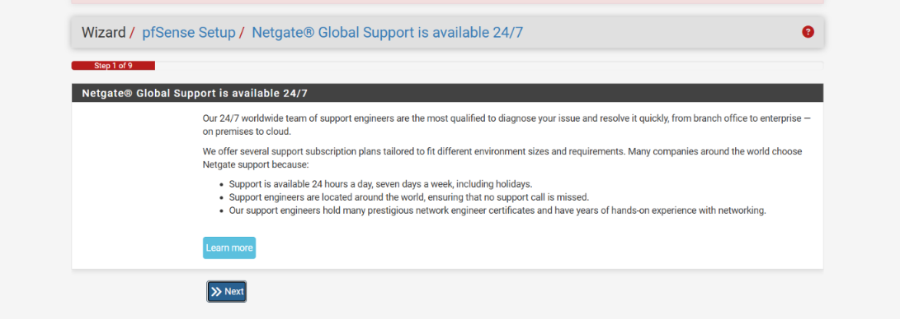
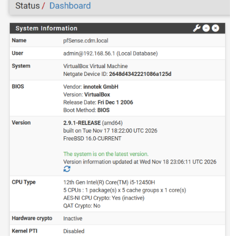
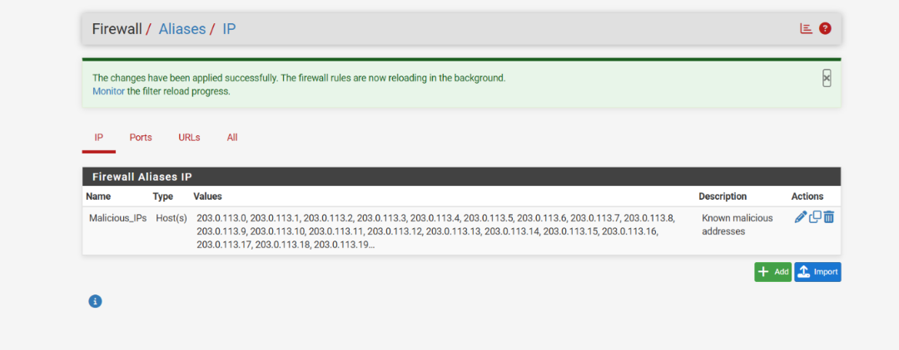
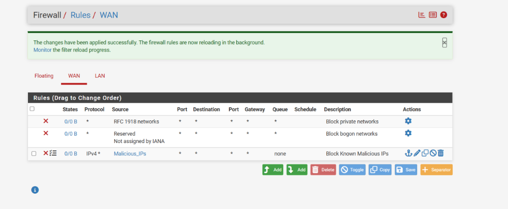
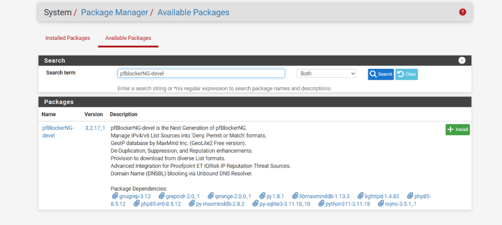
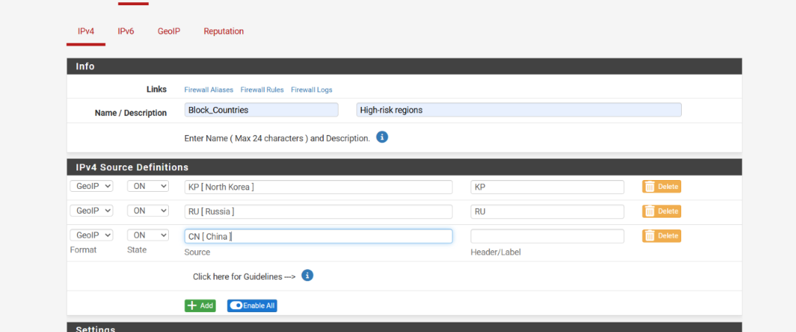
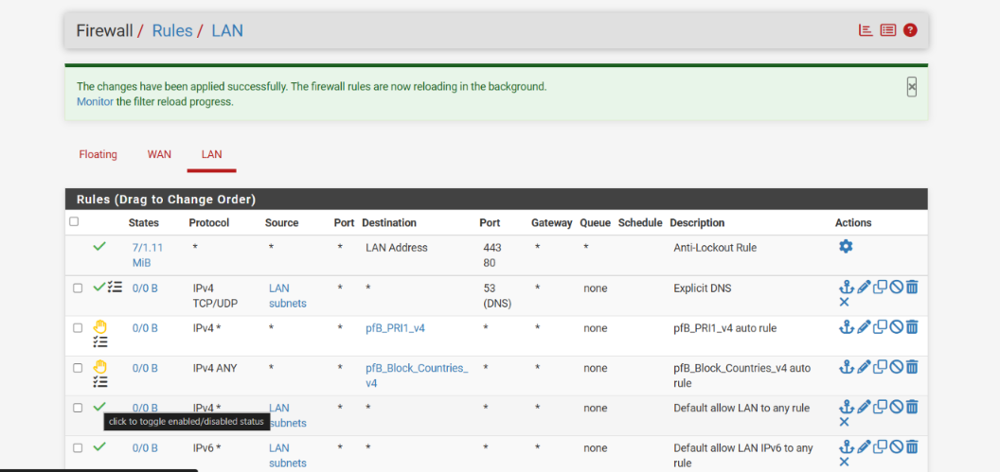
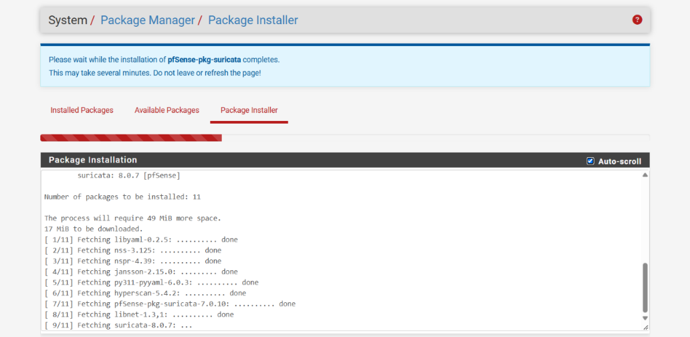

# Real-Time Perimeter Defense with pfSense, pfBlockerNG & Suricata IPS

Deployed a virtualized **pfSense** perimeter firewall with **Suricata IPS** configured for inline blocking and **pfBlockerNG-devel** for GeoIP filtering, routing internal lab traffic through the firewall to inspect and block threats.

## Objective

Move from passive threat detection to active perimeter defense by placing a pfSense firewall between an internal virtual lab network and the internet. This lab covers WAN/LAN rule creation, malicious IP aliases, GeoIP country blocking, Suricata intrusion prevention configuration, and endpoint gateway routing across virtual machines.

## Skills Learned

* **Perimeter Firewall & Rule Design:** Configured WAN/LAN interfaces, created a `Malicious_IPs` host alias, added a WAN block rule with logging, and configured an explicit LAN rule for DNS (`TCP/UDP` port `53`) with logging.
* **GeoIP Threat Filtering:** Installed `pfBlockerNG-devel` and configured a `Block_Countries` GeoIP rule (`KP`, `RU`, `CN`) set to `Deny Both` with weekly updates.
* **Intrusion Prevention (IPS) Setup:** Installed Suricata (`suricata 8.0.7`), enabled **Block Offenders** and **Inline Mode** on `LAN (em1)`, and enabled **ETOpen Emerging Threats** and **ABUSE.ch SSL Blacklist** rule sets.
* **Lab Network Routing & Alert Monitoring:** Configured Ubuntu Netplan routing toward the pfSense LAN gateway (`192.168.56.254`) and inspected live Suricata alerts on the LAN interface.

## Tools Used

* **pfSense Community Edition** (`2.9.1-RELEASE` on FreeBSD)
* **Suricata** (`8.0.7` / `pfSense-pkg-suricata`)
* **pfBlockerNG-devel** (`3.2.17_1`)
* **Oracle VM VirtualBox**
* **Ubuntu Desktop & Ubuntu Server VMs** (with Netplan)

---

## Lab Walkthrough & Screenshots

### 1. Initial pfSense Setup & Dashboard
Completed the pfSense setup wizard (`pfSense.cdm.local`) and verified active `WAN` (`10.0.2.15`) and `LAN` (`192.168.56.254`) interfaces, DNS servers, and system resources on the dashboard.

### 2. Malicious IP Alias & WAN Block Rule
Created a `Malicious_IPs` host alias (`203.0.113.0/24`, `198.51.100.0/24`, `192.0.2.0/24`) and applied a WAN rule blocking traffic from those addresses with packet logging enabled.

### 3. pfBlockerNG GeoIP Filtering & LAN Rules
Installed `pfBlockerNG-devel`, configured the `Block_Countries` GeoIP rule (`KP`, `RU`, `CN`) with `Deny Both` and weekly updates, and verified LAN rules including `Explicit DNS` (port `53`) and `pfB_Block_Countries_v4` rules.

### 4. Suricata IPS Installation, Inline Mode & Rule Sets
Installed Suricata, enabled **Block Offenders** with **Inline Mode** on `LAN (em1)`, and enabled **ETOpen Emerging Threats** and **ABUSE.ch SSL Blacklist** rules.

### 5. Endpoint Routing & Suricata LAN Traffic Inspection
Configured Ubuntu network settings via Netplan (`/etc/netplan/01-network-manager-all.yaml`) so internal lab traffic routes through the pfSense LAN gateway (`192.168.56.254`)[cite: 58, 60]. Verified on the **Suricata Alerts** dashboard that the inspection engine is actively monitoring `(LAN) LAN` traffic from `192.168.56.103` and logging baseline protocol/stream events[cite: 67].

### 6. IPS Inline Blocking Verification (Lab Test Procedure)
To validate active prevention beyond baseline protocol alerts:
1. **Trigger Test Signature:** Run `curl http://testmynids.org/uid/index.html` from the Ubuntu Desktop endpoint to generate a known attack-response pattern (`SID 2100498` — `GPL ATTACK_RESPONSE id check returned root`).
2. **Enforce Drop Action:** In **Services > Suricata > Alerts**, change the triggered rule's action from **Alert** (`yellow`) to **Drop** (`red`) and apply changes.
3. **Confirm Real-Time Blocking:** Re-run `curl http://testmynids.org/uid/index.html`; the request times out before reaching the endpoint, and Suricata logs the packet as **Dropped** in inline mode.
